# Evidencias · Laboratorio guiado Unidad 5 (CLN)

| Dato | Valor |
| :--- | :--- |
| Equipo | EQ7 |
| Integrantes y matrícula | Cesar Maximiliano Peña Mendoza · 2144135 <br> Diego Alberto Sierra Mendoza · 2143733 <br> Arturo Sebastian Pérez Zapata · 2142942 |
| Empresa del PIA | NovaRent (renta de autos) |
| Repositorio GitHub | https://github.com/cesarmax90/ACT05-U5.-Laboratorio-guiado_EQ7 |

## Resumen de resultados

| Verificación | Resultado |
| :--- | :--- |
| Pruebas | 47 PASSED y 1 XFAIL esperada (proyecto base: 13) |
| Cobertura de líneas sobre `src/` | 100 % (55 sentencias; umbral 80 %) |
| `ruff check src tests` | Sin errores |
| Matriz de casos (`datos/matriz_casos_prueba.csv`) | 20 casos: 7 éxito, 9 error, 4 límite; todos PASSED |
| Aplicación al PIA (E9, carpeta `pia_novarent/`) | 20 casos (6 éxito, 6 error, 8 límite), 31 pruebas PASSED, cobertura 100 % |
| Pipeline en GitHub Actions | Ejecuciones verde, roja y verde (ver E8) |

## Hallazgos del proyecto base

| # | Hallazgo | Evidencia | Acción |
| :-- | :--- | :--- | :--- |
| 1 | El CI ejecuta `pytest` y no `python -m pytest`; así `src` no es importable | `ModuleNotFoundError: No module named 'src'` en las 4 suites | `pythonpath = ["."]` en `pyproject.toml` |
| 2 | `requirements.txt` permite `ruff>=0.6`; con ruff 0.17.3 el código base no pasa el lint | `evidencias/E1b_ruff_base.txt`: 12 errores (I001, UP017) | `ruff check --fix`; se recomienda fijar la versión de ruff |
| 3 | `checkout` confirma el pedido antes de saber si el pago fue aceptado | `test_rejected_payment_should_not_leave_order_confirmed` (XFAIL) | Propuesta en E5 |
| 4 | CP08 del CSV describe el comportamiento previo al TDD (confirmaba dos veces) | `ESPERADO_TRAS_TDD` en `tests/test_casos_csv.py` | Esperado actualizado a `ValueError` |

## Tipos de prueba en este proyecto

| Tipo | Qué prueba | Dependencias reales | Archivos |
| :--- | :--- | :--- | :--- |
| Unitaria | Reglas de `Order` y `can_cancel` | Ninguna | `test_order.py`, `test_security.py`, `test_casos_csv.py` |
| Integración | `OrderService` con mock de pasarela y `SqlOrderRepository` con SQLite en memoria | Base de datos de prueba | `test_repository.py`, `test_service.py`, `test_integration.py` |
| E2E | No existe en el proyecto base (no hay API ni interfaz) | — | Solo escenario propuesto |

**Escenario E2E propuesto (no implementado):** un cliente VIP crea un pedido de 200 por la API; el sistema cobra 170 con la pasarela de pruebas, el pedido queda CONFIRMED en una base temporal y el dueño lo cancela dentro de las primeras 24 h.

## E1 · Instalación y ejecución

Comando: `python -m pytest -v` (la salida completa se capturó en dos imágenes consecutivas).

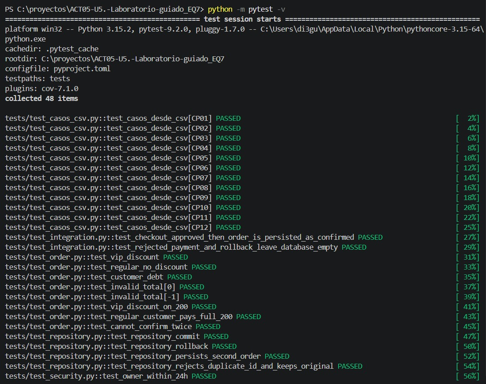

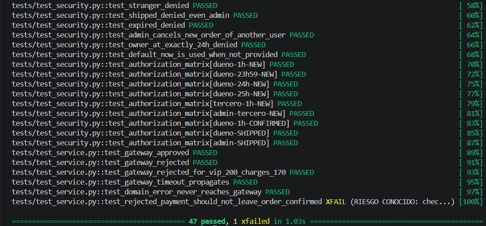

Explicación: `pytest` descubre las funciones `test_*` y reporta cuáles cumplen sus aserciones. El entorno virtual (`venv`) aísla las dependencias del curso para que el resultado sea reproducible en otra máquina.

**Ruff en el proyecto base.** Con ruff 0.17.3 el código original marcaba 12 errores (`I001` imports sin ordenar y `UP017` alias `datetime.UTC`), corregidos con `ruff check --fix`. Salida completa en `evidencias/E1b_ruff_base.txt`.

**La suite detecta defectos.** Al inyectar un defecto a propósito (`VIP_DISCOUNT_RATE` de 0.15 a 0.10), la suite falló en 8 pruebas (`8 failed, 39 passed, 1 xfailed`), entre ellas `test_vip_discount` y `test_vip_discount_on_200`. Salida completa en `evidencias/E1d_defecto_detectado.txt`.

## E2 · Pruebas unitarias nuevas (Arrange–Act–Assert)

```python
def test_vip_discount_on_200():
    # Arrange
    order = Order(200, vip=True)
    # Act
    charge = order.confirm()
    # Assert
    assert charge == 170
    assert order.discount == 30
    assert order.status == "CONFIRMED"


def test_regular_customer_pays_full_200():
    order = Order(200)
    assert order.confirm() == 200
    assert order.discount == 0
    assert order.status == "CONFIRMED"
```

| Entrada | Regla | Resultado esperado | Resultado real |
| :--- | :--- | :--- | :--- |
| Total 200, VIP | Descuento VIP 15 % | Cobro 170, descuento 30, CONFIRMED | PASSED |
| Total 200, regular | Sin descuento | Cobro 200, descuento 0, CONFIRMED | PASSED |

Comando: `python -m pytest tests/test_order.py -v`

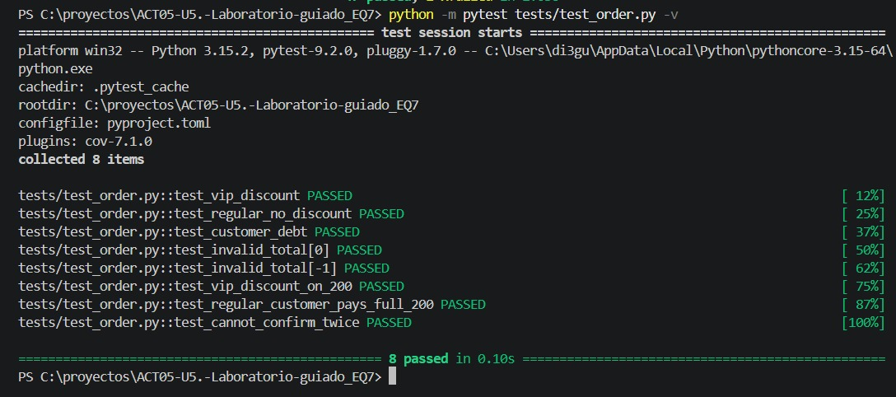

## E3 · TDD: Red → Green → Refactor

Regla nueva: no confirmar un pedido ya confirmado.

**RED.** La prueba se escribió antes de tocar `src/domain.py` y falla porque la versión inicial permite confirmar dos veces:

```python
def test_cannot_confirm_twice():
    order = Order(100)
    order.confirm()
    with pytest.raises(ValueError, match="already confirmed"):
        order.confirm()
```


**GREEN.** Implementación mínima al inicio de `confirm()`:

```python
def confirm(self, customer_debt=0):
    if self.status == "CONFIRMED":
        raise ValueError("already confirmed")
    ...
```


**REFACTOR.** Las validaciones se extrajeron a `_ensure_confirmable`, sin cambiar el comportamiento:

```python
def confirm(self, customer_debt=0):
    self._ensure_confirmable(customer_debt)
    self.discount = round(self.total * VIP_DISCOUNT_RATE, 2) if self.vip else 0.0
    self.status = "CONFIRMED"
    return self.total - self.discount
```

La suite completa en verde después del refactor es la de las capturas de E1 (47 passed, 1 xfailed).

Por qué TDD no es ejecutar pruebas después de programar: la prueba roja demuestra que el defecto existe y que la prueba es capaz de detectarlo; el código se escribe solo para ponerla en verde y el refactor queda protegido por la suite. Una prueba escrita después nunca ha fallado, así que no hay evidencia de que detecte algo.

## E4 · Persistencia, commit y rollback

```python
def test_repository_persists_second_order():
    engine = make_engine()
    with Session(engine) as session:
        SqlOrderRepository(session).save(2, Order(250))
        session.commit()
        row = session.scalar(select(OrderRow).where(OrderRow.id == 2))
        assert (row.id, row.total, row.status) == (2, 250, "NEW")
```

Comando: `python -m pytest tests/test_repository.py -v`

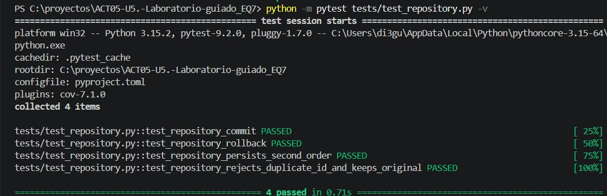

Diferencia: `commit` hace permanentes los cambios de la transacción dentro de la base; `rollback` los descarta y la base queda como antes. Además se probó la restricción de unicidad: un segundo pedido con `id=1` lanza `IntegrityError` y se conserva el original (total 120). Todo ocurre en SQLite en memoria, sin datos reales.

## E5 · Pasarela de pago con mocks

- Pago aprobado: el servicio devuelve el importe y la pasarela se llama una sola vez (`assert_called_once_with(100)`).
- Pago rechazado, VIP de 200: se lanza `RuntimeError("payment rejected")` y el intento de cobro fue por 170.
- Timeout: `TimeoutError` se propaga al llamador.
- Error de dominio (total 0): `charge` no se llama (`assert_not_called`).
- El mock usa `Mock(spec=["charge"])`: solo existe `charge`, no hay red ni dinero real.

Comando: `python -m pytest tests/test_service.py -v -rx`

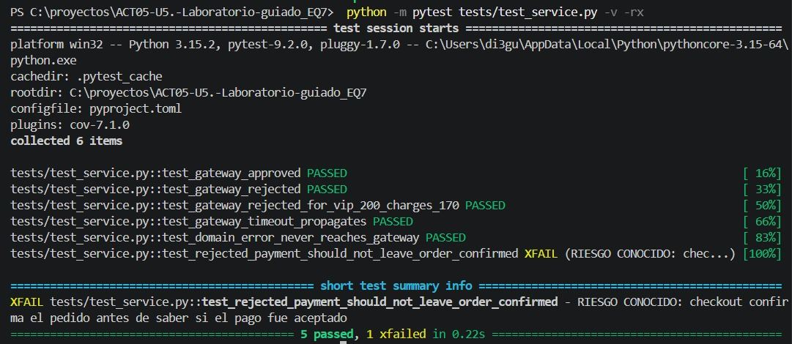

**Riesgo de consistencia (sin ocultarlo).** `checkout` ejecuta `order.confirm()` antes de cobrar. Si la pasarela rechaza o expira, el objeto queda en CONFIRMED sin pago. La prueba `test_rejected_payment_should_not_leave_order_confirmed` lo documenta con `xfail(strict=True)`.

Propuestas de mejora:

| Opción | Idea |
| :--- | :--- |
| A | Calcular el importe sin cambiar el estado, cobrar y marcar CONFIRMED solo si el cobro fue exitoso |
| B | Estado intermedio `PENDING_PAYMENT`; pasa a CONFIRMED al aprobarse el pago |
| C | Compensación: si el cobro falla, restaurar el estado anterior y no hacer commit |

## E6 · Seguridad y autorización

Reglas implementadas: `SHIPPED` nunca se cancela (ni por administrador); para otros estados el administrador puede cancelar; el dueño no administrador solo durante las primeras 24 h (estrictamente menos de 24 h). Las pruebas usan una fecha fija y pasan `now` explícito.

| Rol | ¿Es el dueño? | Estado | Antigüedad | Resultado | Prueba |
| :--- | :--- | :--- | :--- | :--- | :--- |
| Dueño | Sí | NEW | 1 h | Permitido | `dueno-1h-NEW` |
| Dueño | Sí | NEW | 23 h 59 min | Permitido | `dueno-23h59-NEW` |
| Dueño | Sí | NEW | 24 h | Denegado | `dueno-24h-NEW` |
| Dueño | Sí | NEW | 25 h | Denegado | `dueno-25h-NEW` |
| Tercero | No | NEW | 1 h | Denegado | `tercero-1h-NEW` |
| Administrador | No | NEW | 100 h | Permitido | `admin-tercero-NEW` |
| Dueño | Sí | CONFIRMED | 1 h | Permitido | `dueno-1h-CONFIRMED` |
| Dueño | Sí | SHIPPED | 1 h | Denegado | `dueno-SHIPPED` |
| Administrador | No | SHIPPED | 1 h | Denegado | `admin-SHIPPED` |

Comando: `python -m pytest tests/test_security.py -v`

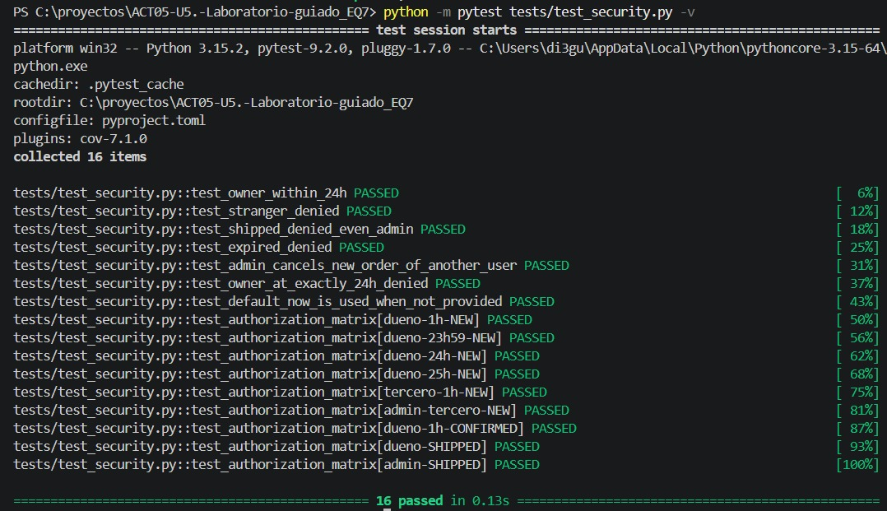

## E7 · Cobertura y calidad

Comandos: `python -m ruff check src tests` y `python -m pytest -v --cov=src --cov-report=term-missing --cov-report=html --cov-fail-under=80`


Reporte HTML (`htmlcov/index.html`, copia en `evidencias/reporte_cobertura_html/`):


La cobertura de líneas es 100 %, pero eso no significa que no haya comportamientos sin probar. Ejemplos reales que ninguna prueba ejercita:

- `can_cancel` con `created_at` sin zona horaria lanza `TypeError` (no se puede restar fecha ingenua y fecha con zona); no hay regla ni prueba que defina qué debe pasar.
- `OrderRow` no tiene columna de descuento: el repositorio guarda el total sin descuento y el estado, no el importe cobrado.
- `customer_debt` negativo se trata como "sin deuda"; no hay prueba que fije ese comportamiento.

Observación: al terminar la ejecución aparecen dos `ResourceWarning` por conexiones SQLite que no se cierran explícitamente en las pruebas de integración. No afectan los resultados; la mejora sería cerrar el motor (`engine.dispose()`) al final de cada prueba.

## E8 · GitHub Actions

Repositorio: https://github.com/cesarmax90/ACT05-U5.-Laboratorio-guiado_EQ7

El workflow `CI Business Logic` (`.github/workflows/ci.yml`) se ejecuta en cada push y pull request: instala dependencias, corre `ruff`, `pytest` con cobertura y umbral de 80 %, `compileall` y publica el reporte `htmlcov` como artefacto. Un segundo job, `pia_novarent`, ejecuta `ruff` y `pytest` con cobertura sobre la carpeta `pia_novarent/` (E9).

Simulación local del ciclo verde → rojo → verde con los mismos pasos del workflow (`scripts/ci_local.sh`):

```text
== COMMIT 1 (verde) ==
1db7138 Unidad 5: pruebas y CI
All checks passed!
Required test coverage of 80% reached. Total coverage: 100.00%
======================== 47 passed, 1 xfailed in 0.57s =========================
CI local: OK
codigo_de_salida=0

== COMMIT 2 (rojo: aserción falsa) ==
3e9fcdc ROMPER: aserción falsa (fallo controlado)
All checks passed!
tests/test_order.py::test_vip_discount FAILED                            [ 31%]
E       AssertionError: assert 85.0 == 86
tests/test_order.py:8: AssertionError
FAILED tests/test_order.py::test_vip_discount - AssertionError: assert 85.0 =...
codigo_de_salida=1

== COMMIT 3 (revertido, verde otra vez) ==
1883e1f Revert "ROMPER: aserción falsa (fallo controlado)"
All checks passed!
Required test coverage of 80% reached. Total coverage: 100.00%
======================== 47 passed, 1 xfailed in 0.59s =========================
CI local: OK
codigo_de_salida=0
```

Qué detecta el pipeline: con una aserción falsa (`assert o.confirm() == 85` cambiada a `== 86`) `pytest` termina con código de salida 1, el job falla y el cambio defectuoso queda marcado en rojo; al revertir el commit el pipeline regresa a verde. La protección obligatoria de merge requeriría configurar branch protection o rulesets en GitHub; el YAML por sí solo no la activa.

### Ejecuciones en GitHub Actions

Workflow *CI Business Logic* en la pestaña Actions del repositorio:

**1. Ejecución verde** (proyecto original, todas las verificaciones pasan):

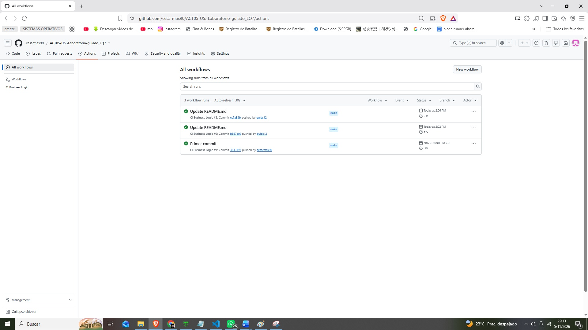

**2. Ejecución roja** (aserción falsa introducida a propósito; el pipeline detecta el fallo):

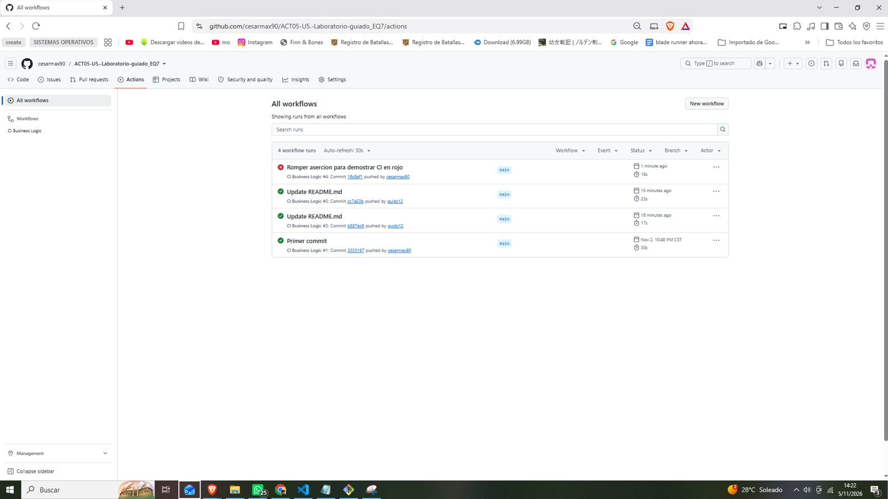

**3. Ejecución verde otra vez** (tras revertir el cambio defectuoso):

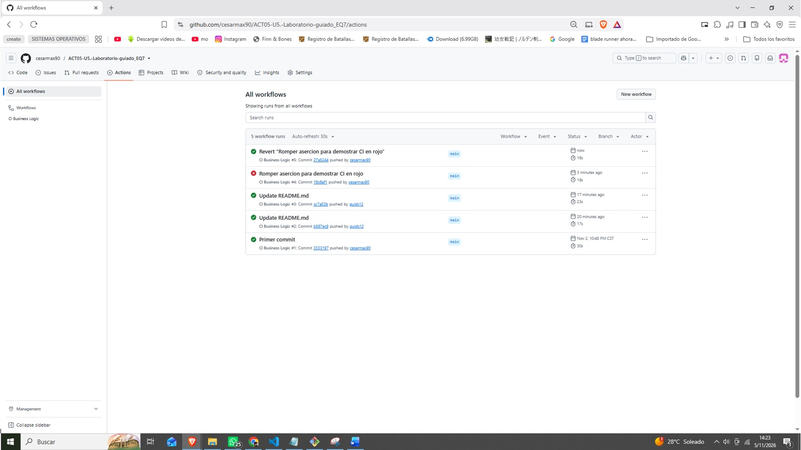

## E9 · Aplicación al PIA (NovaRent)

La empresa del PIA es **NovaRent** (renta de autos por día). Las reglas se tomaron del BRD, las User Stories y el diseño arquitectural de las Unidades 2 y 3. El código está en la carpeta `pia_novarent/`, autocontenida (con su propio `README.md`, `pyproject.toml`, pruebas y matriz), de modo que se pueda trasladar al repositorio del PIA (https://github.com/cesarmax90/pia_cln_proyecto_integrador_ad2026_EQ7) cuando este se cree; hasta entonces, la evidencia de E9 vive en esta carpeta. El pipeline la ejecuta en el job `pia_novarent` de `.github/workflows/ci.yml`.

### Reglas seleccionadas

| Regla | US | Parámetros (BRD / Unidad 3) | Clase |
| :--- | :--- | :--- | :--- |
| Cargo por kilometraje excedente | US14 | 200 km/día incluidos, $3 MXN por km extra | `PoliticaCargos` |
| Autorización de extensión por rol | US11, US12 | Agente hasta 48 h; más de 48 h requiere Administración; solicitud con 2 h o más de anticipación | `PoliticaExtension` |
| Cancelación y no-show | US03, US04 | Cancelación gratuita con 24 h o más; no-show se libera a las 2 h | `PoliticaCancelacion` |

### Matriz de casos de prueba

Archivo: `pia_novarent/datos/matriz_casos_pia.csv` (20 casos: 6 éxito, 6 error y 8 límite). Cada caso enlaza con su prueba por el id `CP-PIA-NN`.

| ID | Regla | Entrada | Resultado esperado | Tipo | Resultado |
| :--- | :--- | :--- | :--- | :--- | :--- |
| CP-PIA-01 | Km excedente (US14): 200 km/día incluidos, $3 por km extra | 3 días, 750 km | Cargo $450 (150 km excedentes) | Éxito | PASSED |
| CP-PIA-02 | Km excedente (US14): el kilometraje no puede ser negativo | 1 día, -1 km | ValueError | Error | PASSED |
| CP-PIA-03 | Km excedente (US14): exactamente lo incluido no genera cargo | 1 día, 200 km | Cargo $0 | Límite | PASSED |
| CP-PIA-04 | Km excedente (US14): 1 km sobre lo incluido | 1 día, 201 km | Cargo $3 | Límite | PASSED |
| CP-PIA-05 | Extensión (US11): el agente aprueba hasta 48 h | Agente, +24 h, vence en 10 h | APROBADA; vencimiento +24 h | Éxito | PASSED |
| CP-PIA-06 | Extensión (US11): se pide con 2 h de anticipación mínima | Agente, +24 h, vence en 1 h 58 min | ExtensionFueraDeTiempo | Error | PASSED |
| CP-PIA-07 | Extensión (US11): 48 h exactas las aprueba el agente | Agente, +48 h, vence en 10 h | APROBADA | Límite | PASSED |
| CP-PIA-08 | Extensión (US12): más de 48 h requiere Administración | Agente, +49 h, vence en 10 h | REQUIERE_AUTORIZACION; vencimiento sin cambio | Límite | PASSED |
| CP-PIA-09 | Extensión (US11): anticipación de exactamente 2 h es válida | Agente, +24 h, vence en 2 h | APROBADA | Límite | PASSED |
| CP-PIA-10 | Cancelación (US03): gratis con 24 h o más de anticipación | Cancelar 48 h antes del inicio | Estado Cancelada, sin penalización | Éxito | PASSED |
| CP-PIA-11 | Cancelación (US03): no se cancela dos veces | Reservación ya Cancelada | ValueError | Error | PASSED |
| CP-PIA-12 | Cancelación (US03): 24 h exactas no penalizan | Cancelar 24 h antes del inicio | Estado Cancelada, sin penalización | Límite | PASSED |
| CP-PIA-13 | Cancelación (US03): 23 h 59 min sí penalizan | Cancelar 23 h 59 min antes | Estado Cancelada, con penalización | Límite | PASSED |
| CP-PIA-14 | No-show (US04): se libera pasadas 2 h | 3 h después del inicio | Estado Liberada | Éxito | PASSED |
| CP-PIA-15 | No-show (US04): no se libera dentro de la ventana | 1 h 58 min después del inicio | ValueError; sigue Creada | Error | PASSED |
| CP-PIA-16 | No-show (US04): exactamente 2 h se libera | 2 h después del inicio | Estado Liberada | Límite | PASSED |
| CP-PIA-17 | Persistencia: la reservación sobrevive al commit | Guardar R-100 y hacer commit | Se recupera con los mismos datos | Éxito | PASSED |
| CP-PIA-18 | Persistencia: rollback descarta la reservación | Guardar R-100 y hacer rollback | obtener_por_folio devuelve None | Error | PASSED |
| CP-PIA-19 | Pasarela (mock): depósito aprobado abre el contrato | retener_deposito devuelve DEP-OK-1 | Contrato Abierto; pasarela llamada 1 vez con 5000 | Éxito | PASSED |
| CP-PIA-20 | Pasarela (mock): depósito rechazado no abre el contrato | retener_deposito devuelve None | RuntimeError; contrato sigue Pendiente | Error | PASSED |

Los casos CP-PIA-17 y CP-PIA-18 cubren la persistencia (SQLite en memoria, commit y rollback) y CP-PIA-19 y CP-PIA-20 el servicio externo: la `PasarelaPago` se sustituye por un `Mock(spec=["retener_deposito"])`, por lo que no hay cobros reales. Además de la matriz hay pruebas de unicidad del folio, timeout de la pasarela y rol sin permiso.

### Ejecución y cobertura

Desde `pia_novarent/`:

```bash
python -m ruff check novarent tests
python -m pytest -v --cov=novarent --cov-report=term-missing --cov-report=html --cov-fail-under=80
```

Resultado: Ruff sin errores, 31 pruebas PASSED y cobertura de líneas de 100 % sobre `novarent/` (123 sentencias; umbral 80 %).

Terminal con ambos comandos ejecutados dentro de `pia_novarent/`:

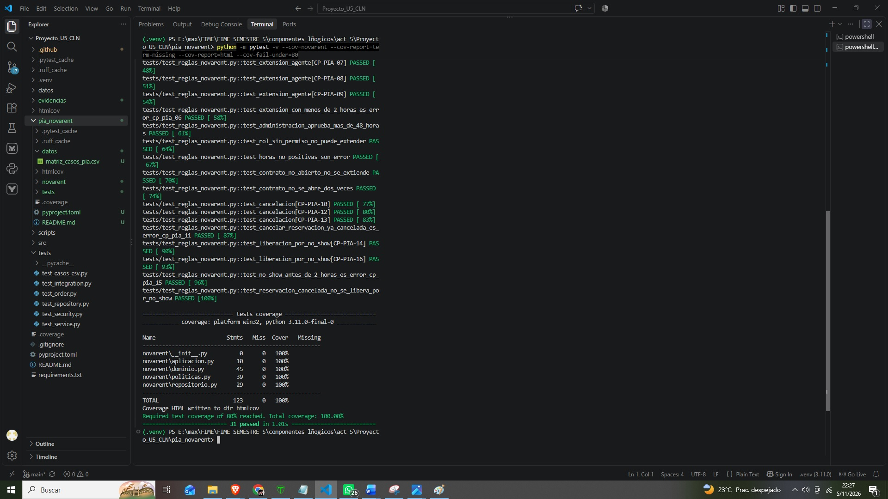

Reporte HTML de cobertura (`pia_novarent/htmlcov/index.html`):

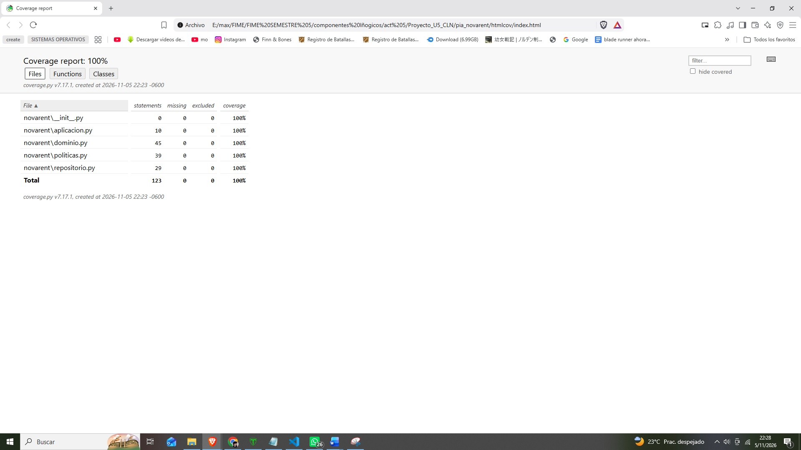

**Las pruebas detectan defectos.** Al inyectar dos defectos a propósito (tarifa por km de $3 a $4 y límite del agente de 48 h a 72 h), fallaron CP-PIA-01, CP-PIA-04 y CP-PIA-08 (`3 failed, 28 passed`). Salida en `evidencias/E9_defecto_detectado.txt`.

### Decisiones de diseño

- **Políticas parametrizables y puras.** Los valores de negocio (200 km, $3, 48 h, 2 h, 24 h) se reciben por constructor; cambiar una política no toca los servicios ni el dominio.
- **El dominio no conoce SQLAlchemy ni la pasarela.** Las reglas se prueban sin base de datos; la persistencia vive en `repositorio.py` y la pasarela es un puerto sustituible.
- **Depósito primero, contrato después.** `ContratoAppService.abrir_contrato` retiene el depósito antes de abrir el contrato, así un rechazo o un timeout deja el contrato en `Pendiente`. Con esto se evita el riesgo de consistencia que en E5 se documentó para `checkout`.
- **Fechas fijas.** Todas las pruebas pasan `ahora` explícito; el resultado nunca depende del reloj.
- **Roles.** Un rol distinto de Agente o Administración recibe `PermissionError`.
- **Fuera de alcance por datos incompletos.** El monto de la penalización por cancelación tardía y las tarifas de retraso y de combustible por octavo no están definidos en el BRD (la Unidad 3 marca la tarifa por octavo como "por definir"), por lo que no se inventaron: la cancelación solo indica si aplica penalización. Las cifras del negocio deben validarse con el cliente antes de producción, como indica el BRD.

## Registro de uso de IA

| Campo | Detalle |
| :--- | :--- |
| Prompt usado | Resumen de lo solicitado a la IA (Claude), con los documentos del laboratorio y de las Unidades 2 y 3 como contexto: (1) revisar el repositorio frente a las instrucciones del laboratorio; (2) completar `EVIDENCIAS_U5.md` con datos del equipo, capturas y reflexión final; (3) a partir del BRD, las User Stories y el diseño arquitectural de NovaRent, proponer tres reglas y escribir pruebas pytest de éxito, error y límite, con persistencia en SQLite y mock de la pasarela de pago. |
| Caso sugerido y corregido | Tomar el resultado esperado de CP08 desde el CSV (`CONFIRMED`) habría hecho fallar la prueba después del TDD |
| Corrección manual | `ESPERADO_TRAS_TDD = {"CP08": "ValueError"}` en `tests/test_casos_csv.py` |
| Prueba añadida | `test_cannot_confirm_twice` y la parametrización desde `datos/casos_de_prueba.csv` |

## Reflexión final

El defecto más costoso en producción sería cobrar mal o dejar confirmado un pedido cuyo pago fue rechazado. En nuestro proyecto, el servicio de checkout confirma el pedido antes de saber si la pasarela aceptó el cobro; si el pago se rechaza o expira, el pedido queda en estado CONFIRMED sin haberse pagado y la empresa entregaría mercancía sin cobrarla. Otro defecto grave sería permitir confirmar dos veces el mismo pedido, porque podría duplicar cobros. Dos pruebas evitan estos casos: test_cannot_confirm_twice, que surgió del ciclo TDD, y test_rejected_payment_should_not_leave_order_confirmed, que usa un mock de la pasarela para verificar el estado final y está marcada como xfail estricta para dejar visible el riesgo hasta que se corrija. También comprobamos que el 100 % de cobertura no demuestra corrección: el riesgo del checkout existía con todas las líneas ejecutadas. Lo que da valor a una prueba son sus aserciones y los escenarios que cubre, no el porcentaje, y el pipeline de integración continua evita que un cambio posterior rompa estas reglas sin que el equipo se entere.

## Autoevaluación

- [x] Una prueba unitaria no requiere base de datos (dominio y seguridad se prueban sin SQLAlchemy)
- [x] Evidencia real de RED y GREEN
- [x] Diferencia entre commit y rollback
- [x] El mock no genera cargo real (`Mock(spec=["charge"])`)
- [x] Permisos y límites temporales comprobados con fechas fijas
- [x] Cobertura ≥ 80 % sin ocultar módulos (`src/` completo)
- [x] Pipeline ejecutado en GitHub y fallo detectado (E8)
- [x] Casos del PIA con reglas reales de la empresa: 20 casos de NovaRent, más de los nueve requeridos (E9)
