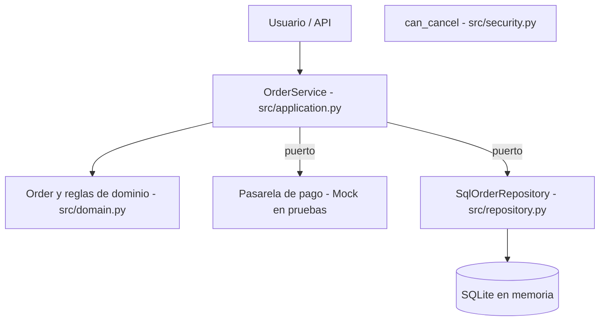

# Unidad 5 CLN - Pruebas, Integración y Calidad 


Proyecto de pedidos con reglas de negocio probadas con pytest, SQLAlchemy (SQLite en memoria), mocks de pasarela de pago, política de cancelación y pipeline en GitHub Actions.

## Instalación y comandos

**Windows (PowerShell)**

```powershell
py -3.11 -m venv .venv
.\.venv\Scripts\Activate.ps1
python -m pip install -r requirements.txt
```

**macOS / Linux**

```bash
python3 -m venv .venv
source .venv/bin/activate
python -m pip install -r requirements.txt
```

**Verificaciones (iguales a las del pipeline)**

```bash
python -m ruff check src tests
python -m pytest -v --cov=src --cov-report=term-missing --cov-report=html --cov-fail-under=80
python -m compileall -q src
```

O todo junto: `sh scripts/ci_local.sh`. El reporte HTML queda en `htmlcov/index.html`.

## Arquitectura



El dominio no importa SQLAlchemy ni bibliotecas de pago. Las pruebas unitarias no usan base de datos; las de integración usan SQLite en memoria; la pasarela siempre es un mock (nunca hay cobros reales).

## Estructura

| Ruta | Contenido |
| :--- | :--- |
| `src/` | Dominio, servicio de cobro, repositorio y política de cancelación |
| `tests/` | Unitarias (`test_order`, `test_security`), integración (`test_repository`, `test_integration`), mocks (`test_service`) y casos desde CSV (`test_casos_csv`) |
| `datos/` | CSV didácticos y `matriz_casos_prueba.csv` (20 casos con resultado real) |
| `evidencias/` | Salidas reales de cada paso (E1–E8) y reporte HTML de cobertura |
| `.github/workflows/ci.yml` | ruff → pytest + cobertura ≥80% → compileall → artefacto `htmlcov` |
| `EVIDENCIAS_U5.md` | Bitácora E1–E9 con explicaciones |

## Decisiones de diseño y cambios sobre el proyecto base

| Cambio | Motivo |
| :--- | :--- |
| `pythonpath = ["."]` en `pyproject.toml` | El CI ejecuta `pytest` (sin `python -m`) y fallaba con `ModuleNotFoundError: src` |
| Imports ordenados y `datetime.UTC` | `ruff` 0.17 marcaba 12 errores en el código base |
| Regla `already confirmed` en `Order.confirm()` | Ciclo TDD (E3) |
| `test_rejected_payment_should_not_leave_order_confirmed` con `xfail(strict=True)` | Documenta el riesgo de consistencia de `checkout` sin ocultarlo; si alguien lo corrige, la prueba obliga a quitar la marca |
| Regla de cancelación | `SHIPPED` nunca se cancela, ni por administrador (prioridad sobre el rol) |
